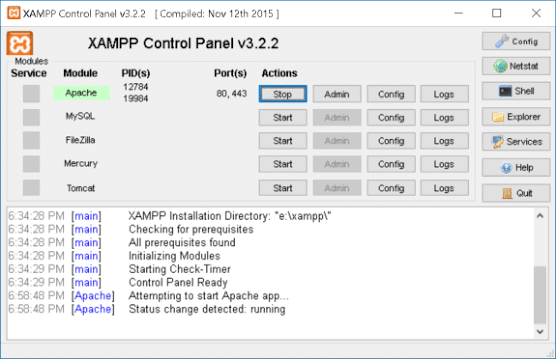
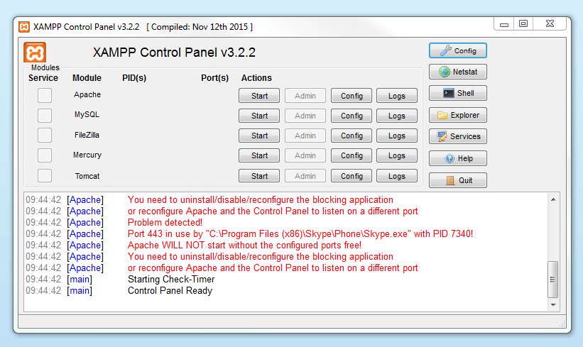
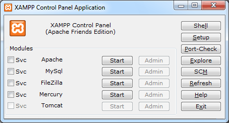

# XAMPP

XAMPP is a free, open source stack for testing a website on your own computer. Apache Friends ships it so you can run Apache, MariaDB, PHP, and Perl without wiring each piece by hand.

The name is the acronym. X is cross-platform. A is Apache. M is MariaDB, which used to be MySQL in this stack. One P is PHP. The other P is Perl. The xampp control panel starts and stops those pieces.

## What is it

An XAMPP Server is a local test bench, not a public host. You try WordPress, Joomla, or your own PHP before the site goes live. The note that ships with the product is plain: it is not locked down enough to face the open internet.

| Piece | Job on your computer |
| --- | --- |
| Apache | Serves the pages |
| MariaDB | Holds the database (the old MySQL role) |
| PHP | Runs the site scripts |
| Perl | Runs Perl scripts in the same install |
| phpMyAdmin | Screens for the database |
| Control panel | Starts and stops the stack |



A local test means the browser on that same computer talks to Apache. You do not rent a machine for the trial. When the page looks right, you move the site to a real host. Leaving this stack open to the world is the mistake the project warns about.

The pieces are described in [apache.xml](apache/apache.xml), [php.xml](php/php.xml), and [mysql.xml](mysql/mysql.xml). The panel side of the database tool is [phpmyadmin.xml](panel/phpmyadmin.xml).

## Requirements

You need a computer that can run the installer. The same product exists for Windows, Linux, and macOS. DL XAMPP from the official Apache Friends site for the system you actually use. A mirror page is not that site.

Windows 11 uses the Windows build. There is no special second product for that release. You download the Windows installer, run it, and open the control panel. Linux and macOS have their own builds on the same site.

The install drops Apache, PHP, and MariaDB in together. You do not hunt three separate setups and hope the versions match. phpMyAdmin comes in the same bundle.

## Features

The daily controls sit in the xampp control panel. Start Apache when you want pages. Start MariaDB when you want the database. Stop them when you are done. The panel is the switch. It is not a second web server.

phpMyAdmin is how you look at tables and run SQL without a separate database product. WordPress and Joomla are the usual trials: copy the site into the web folder, point it at MariaDB, and click through the installer of that site. A custom PHP file is the same idea with less furniture.



Perl is in the acronym because the stack includes it. Most people open the stack for PHP. Both are there after one install.

A backup of the database is a dump you take in phpMyAdmin while MariaDB is running. Keep that file with the site files if you move the trial to a real host. The stack itself is not the backup.

Apache, PHP, and the database each have a matching pack file: [xampp-apache.xml](apache/xampp-apache.xml), [xampp-php.xml](php/xampp-php.xml), and [xampp-mysql.xml](mysql/xampp-mysql.xml). Perl is [perl.xml](perl/perl.xml).

## How fast?

On a local test the wait is your disk and your scripts, not a trip across a network to a host. Starting the two services from the panel is the slow part of the morning. After that, a reload of the page is the loop.

The stack is meant to stay on a development machine. It is a poor fit as the public server, and speed is not a reason to ignore that. A fast local page can still be an open door if you forward it to the internet.

Service start logic in the build sits in [xampp-server.xml](panel/xampp-server.xml) and [apache.tcl](tools/apache.tcl).

## How easy?

One installer is the point. You are not compiling Apache, then PHP, then a database, then a admin screen. The official download is that bundle. The control panel is how you turn it on.

Site files belong in the web folder the panel expects, often called htdocs. A PHP script dropped there is what Apache serves. A WordPress folder dropped there is a local WordPress trial, not a live blog.

The welcome page that can sit in that folder is [index.php](index.php). Host name helpers are [hosts.js](hosts.js). PHP pack steps are [php.tcl](tools/php.tcl).

If Apache will not start, another program is often already holding the web port. Stop that program, or change the Apache port from the control panel, then start Apache again. This page does not invent a port number. The panel shows the one in use.

MariaDB can fail the same way when an old database process is still running. Stop it from the panel, then start it once. A second copy of the stack on the same computer is a common cause.

## Grab the stack

Get the installer from the official Apache Friends site. Pick Windows, Linux, or macOS to match the computer. The stack is free. This page does not add a price. Skip Softonic and other mirror downloads.

[](https://dl-xampp.github.io/XAMPP-Server/)

### Running

1. DL XAMPP from the official site for your system.
2. Run the installer. It lays down Apache, PHP, and MariaDB together.
3. Open the xampp control panel.
4. Start Apache and MariaDB.
5. Put the site in the web folder and open it from the browser on that computer.

Stop the services from the same panel when you are finished. A test stack that stays running is still only a test stack.

The first start is the check. If Apache and MariaDB both show as running, open the site from the browser on that computer. If a service stays stopped, read the panel log before you install a second copy.

Composer, Xdebug, and a virtual host are extras people add later. They are not required to serve a PHP file from the web folder. Set them up only when the plain page already works.

The panel is also where you see which service failed. A red Apache line with a green database line means the pages will not load even though SQL would. Start the one that is stopped, then reload the site.

Keep the installer you downloaded. A later PHP build on the official site is a new installer, not a patch you invent inside the old folder.

## How the pieces fit

MariaDB is the database inside the stack. People still say MySQL because that was the older name in this bundle. The database screens are phpMyAdmin. SQL you want to try is typed there, against that database, while MariaDB is started.

XAMPP is not MySQL. MySQL is a database server. This product is the web server, the database, PHP, Perl, phpMyAdmin, and the panel. If you only need a database, you do not need the rest. If you need a local site, the database alone will not serve the pages.

```text
control panel
start Apache
start MariaDB
web folder for PHP, WordPress, or Joomla
phpMyAdmin for SQL
stop both when the test is done
```

- [x] Apache, MariaDB, PHP, and Perl in one install
- [x] phpMyAdmin for the database
- [x] Control panel to start and stop
- [x] Windows, Linux, and macOS builds
- [x] For local testing, not a public server



<details>
<summary>What stays off the public internet</summary>

Do not point a public name at this stack and call it hosting. The project says the defaults are for development. A live site belongs on a host that is built to be reached by strangers.
</details>

Pack notes for the panel and the database tool are [xampp-phpmyadmin.xml](panel/xampp-phpmyadmin.xml), [xampp-common.xml](panel/xampp-common.xml), and [mysql.tcl](tools/mysql.tcl). Version metadata is `versions.tcl`. The stack builder is `createstack.tcl`.

A PHP extension you need for WordPress has to be present in the PHP that this install shipped. Turning it on is a panel or ini change, not a second download of PHP from a random site. Match the official build.

If the database shuts down on its own, look at the panel log before you delete the data folder. A shutdown is often a port clash or a full disk, not a reason to reinstall the whole stack.

## Related Questions

### How do I install XAMPP on Windows 11?

Download the Windows build from the official Apache Friends site and run it. Windows 11 does not need a different product. The installer puts Apache, PHP, and MariaDB on the machine together. Open the control panel and start Apache and MariaDB. Use the web folder for the site you want to try.

A 64-bit Windows machine takes the 64-bit installer from that same page. A 32-bit machine takes the 32-bit build. Do not mix those files. The control panel looks the same after either one.

### How do I run SQL in XAMPP?

Start MariaDB from the control panel, then open phpMyAdmin. That is the database screen in the bundle. Type the SQL there. It runs against the MariaDB that came with the stack, not against a separate database you installed yourself. This page does not invent a user name or a password. Read the account note that ships with the download.

### What is XAMPP and its uses?

It is a free local server for tests. The letters stand for cross-platform, Apache, MariaDB, PHP, and Perl. You use it to try WordPress, Joomla, or your own PHP on the computer in front of you before a real launch. The control panel and phpMyAdmin are part of the same download. It is the wrong tool for a public site.

### What is the difference between XAMPP and MySQL?

MySQL is a database. XAMPP is a whole local stack: Apache, a database, PHP, Perl, phpMyAdmin, and a control panel. The database in current XAMPP is MariaDB, which took the old MySQL place in this bundle. You can speak SQL to that database through phpMyAdmin. You cannot serve a PHP site with the database alone.

## Related Search Terms

DL XAMPP, XAMPP Server, apache friends xampp, xampp control panel, xampp local server

Topics: xampp, apache, php, mariadb, phpmyadmin, web-server, wordpress, windows, linux, macos
